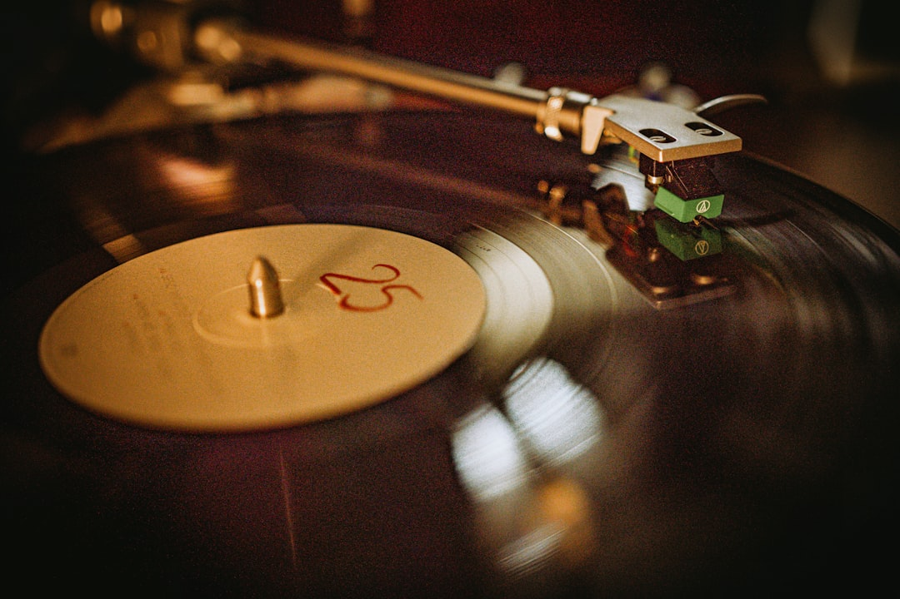

Photo by <a href="https://unsplash.com/@henrylaiphotography?utm_source=artlines_blog&utm_medium=referral">Henry Lai</a> on <a href="https://unsplash.com/?utm_source=artlines_blog&utm_medium=referral">Unsplash</a>

Few arguments in audio have outlasted the vinyl vs. CD debate. It started in the early 1980s when the compact disc arrived with promises of "perfect sound forever," and it has never really stopped. Vinyl sales have grown considerably in recent years, while CD sales have declined. So which format sounds better? The answer is less straightforward than either side usually admits, and it depends on equipment, mastering, and what you mean by "better."

This article summarizes format specifications and general findings from published discussions of blind testing. It is not based on original listening tests or measurements.

## How Vinyl and CD Store Sound Differently

Vinyl and CD are not competing implementations of the same idea. They are different approaches to storing and reproducing audio.

Vinyl records store sound as a physical groove cut into a disc. The groove's shape corresponds to the audio waveform, and a stylus tracking that groove converts mechanical movement into an electrical signal, which is then amplified. There is no sampling or digital conversion in playback, though the signal still passes through cutting, pressing, and playback processes that alter it, including RIAA equalization. (Many modern records are also mastered from digital sources.)

CDs store sound as a sequence of digital samples. According to the Nyquist sampling theorem, a sample rate of 44,100 samples per second can represent frequencies below 22,050 Hz, which covers the commonly cited range of human hearing (roughly 20 Hz to 20,000 Hz). Each sample is encoded at 16-bit depth, giving 65,536 possible amplitude values. At playback, a digital-to-analog converter (DAC) reconstructs the waveform from those samples.

Both approaches involve engineering tradeoffs, and understanding them helps in interpreting claims about listening comparisons.

## The Technical Case for CD

On paper, the CD format compares favorably on most common measurements. The figures below are typical or theoretical values. Actual hardware performance varies.

**Signal-to-noise ratio:** The 16-bit CD format has a theoretical dynamic range of roughly 96 dB. Vinyl is commonly cited at about 60-70 dB, depending on pressing quality, cartridge, and condition. Surface noise on vinyl is often audible in quiet passages, while CD noise is typically far lower in practice.

**Frequency response:** The CD format can represent 20 Hz to 20,000 Hz, though real players vary in how flat their output is. Vinyl requires the RIAA equalization curve to be applied during cutting and reversed during playback. If your [phono preamp](/2026/03/16/phono-preamps-explained/) does not apply the RIAA correction accurately, the frequency balance shifts. Many quality phono stages handle this well, but it is a variable that CD playback does not have.

**Channel separation:** CD channel separation is typically very high, often cited as exceeding 90 dB. Vinyl channel separation depends on the cartridge and setup, commonly cited at roughly 25 dB to 35 dB. Crosstalk between channels is measurable and may slightly affect stereo imaging.

**Format wear:** A CD in good condition can be read repeatedly without change in the audio data, assuming no disc damage and a functioning player. Vinyl playback causes gradual groove wear, and a worn stylus can accelerate it. Wear rates depend on tracking force, stylus condition, and record cleanliness.

**Dynamic range:** Much modern music is heavily compressed in mastering, which limits how much this matters in practice. For recordings with wide dynamics, such as orchestral works, the CD format's larger theoretical dynamic range is an advantage over vinyl.

## The Case for Vinyl

If CD compares well on most measurements, why does vinyl have such a devoted following?

Several factors are not captured well by basic specifications.

**Harmonic distortion that some find pleasant:** Vinyl playback introduces distortion, which can include second-order harmonics. In small amounts, some listeners describe this as "warm." Tube amplifiers are often described as having a similar character, though this varies by design. Whether this is a pleasing coloration or an inaccuracy depends on the listener's priorities.

**The mastering variable:** This is a major factor in the format debate. The same album released on vinyl and CD is often mastered differently. Vinyl's physical limits place constraints on extreme loudness and certain frequency content, so vinyl masters have in some cases been more dynamic than loudness-maximized CD masters. A vinyl pressing of a 1970s album may sound better than a heavily compressed CD reissue because of the mastering, not the format. Separating format from mastering is difficult.

**The early digital problem:** Some criticism of early CD sound was warranted. Early players commonly used less refined DACs, steep filters near the 22 kHz limit, and had timing (jitter) issues. Complaints that early CDs sounded "harsh" or "clinical" may reflect limitations of early digital hardware and mastering rather than the format's fundamental capabilities. Modern converters generally perform much better.

**Physical ritual and engagement:** Many people value the ritual of vinyl listening: cleaning the record, cueing the stylus, flipping the side. This may encourage more attentive listening. Whether that counts as vinyl "sounding better" is a matter of opinion.

## Specs Head-to-Head

Values are typical or theoretical figures, not measurements of specific products.

| Characteristic | Vinyl | CD |
|---|---|---|
| Frequency response | Roughly 20 Hz - 20 kHz (RIAA EQ dependent) | 20 Hz - 20 kHz (format specification) |
| Dynamic range | ~65-70 dB typical | ~96 dB theoretical |
| Signal-to-noise ratio | ~60-70 dB | Up to ~96 dB theoretical |
| Channel separation | ~25-35 dB | Often greater than 90 dB |
| Format degradation | Gradual wear with play | None to the data (disc damage aside) |
| Mastering differences | Common | Common |
| Playback chain complexity | Higher | Lower |

## What Blind Listening Tests Can and Cannot Tell Us

Blind or double-blind tests, in which neither the listener nor the experimenter knows which format is playing, are the standard method for separating perception from expectation. This article does not report new tests, and it does not cite specific studies, so the points below should be read as general observations rather than documented findings.

A well-designed comparison would use the same recording and master, matched output levels, and a blind panel. Under such conditions, differences between high-quality digital playback and well-maintained vinyl are generally reported to be small, and results vary between listeners. The [Audio Engineering Society](https://www.aes.org) publishes research on audio perception, and readers who want specifics should consult its library directly for studies on format comparison.

Sighted listening, where the listener can see which format is playing, is widely understood to be influenced by expectation. This does not make the experience less real, but it changes what a stated preference means.

Blind tests also have limitations. They may not capture the effect of better masterings on some vinyl releases, the engagement of the listening ritual, or long-term familiarity with a well-tuned system.

Where vinyl is preferred for a particular title, the cause is often mastering differences rather than any inherent quality of the groove medium, though this cannot be established for any given release without comparing the actual masters.

## Common Mistakes That Make Either Format Sound Worse

Both formats can give excellent or disappointing results. Many problems come from avoidable setup and equipment issues.

### Vinyl Mistakes

A worn or damaged stylus is a common cause of degraded vinyl sound. Manufacturers often cite stylus lifetimes on the order of several hundred to a couple thousand hours depending on stylus shape, so check your cartridge's documentation. If your vinyl sounds veiled, distorted in the inner grooves, or lacking in high-frequency detail, the stylus is a reasonable first thing to check. See our guide on [replacing a turntable stylus](/2026/04/02/how-to-replace-a-turntable-stylus/) if you suspect yours is overdue.

Improperly set tracking force can cause audible distortion and accelerated record wear. Setting force too low is not necessarily safer than the specified force, since a stylus that mistracks can damage the groove walls. Follow the cartridge manufacturer's recommended range and use a stylus force gauge rather than guessing.

A cheap or poorly matched phono preamp can affect frequency response and add noise. If the RIAA curve is applied inaccurately, bass and treble balance shift in ways that could be mistaken for "vinyl sound."

### CD Mistakes

Budget playback hardware can have weaker analog output stages and converters, which may produce harshness or reduced detail. The DAC in a budget DVD player or inexpensive portable CD player may not match a good standalone DAC or CD transport, though measured performance varies by model.

Failing to match output levels is a pervasive problem in informal comparisons. Louder playback is commonly perceived as better. If one format is even 1-2 dB louder at the listening position, listeners may prefer it for that reason alone.

Dismissing CD as "just digital" ignores the wide range of quality in digital hardware, just as dismissing vinyl as "just noise and distortion" ignores the range in analog setups.

## FAQ

**Does vinyl sound warmer than CD?**

Many listeners describe it that way. Vinyl playback can add low-level distortion, including second-order harmonics, and some setups roll off high frequencies slightly, which listeners may perceive as warmth. Whether that is a coloration or a faithful rendering depends on the system, the record, and your priorities. Preferring it is a legitimate choice.

**Is vinyl higher resolution than CD?**

Not by standard technical measures. A properly mastered 44.1 kHz / 16-bit CD can represent the full audible frequency range and a dynamic range exceeding that of vinyl. Vinyl typically has a higher noise floor, more distortion, and less channel separation. Whether 16-bit / 44.1 kHz is audibly sufficient in all cases is debated, though it is generally considered adequate for playback of final masters.

**Why do some audiophiles prefer vinyl if CD measures better?**

Several reasons may apply. Vinyl releases of some classic titles have different, sometimes more dynamic, masterings. Some listeners find vinyl's distortion character pleasant. The listening ritual may promote focused engagement. And for many, the aesthetic and tactile aspects of the format have value independent of measured performance.

**Does CD quality degrade over time?**

Properly stored CDs often last for decades, but "CD rot," caused by manufacturing or storage problems, affects some discs. A disc in good condition is read by the player as the same data each time. Vinyl wears with play, though the rate is slow with a fresh stylus, correct setup, and clean records.

**Is it worth buying a CD player in 2026?**

If you value physical media, a CD transport and DAC (or a CD player) gives you access to a large library, and used CDs are often inexpensive. Prices and availability vary by location. Whether it is worth it depends on your existing system and listening habits.

## Recommended Products

As an Amazon Associate, I earn from qualifying purchases.

Getting the most from vinyl requires a phono stage that applies accurate RIAA equalization with low noise. The products below are listed as options based on their manufacturer-described features. We have not tested them for this article, and you should check current specifications and independent measurements before buying.

**[Fosi Audio Box X5 Phono Preamp](https://www.amazon.com/dp/B0DLVZF5Y7?tag=analogrevivalist-20)** - A compact phono stage described by the manufacturer as supporting MM and MC cartridges. Accurate RIAA equalization matters for how vinyl compares with CD.

**[Pro-Ject Audio Phono Box DC MM/MC Phono Preamp](https://www.amazon.com/dp/B007DB5I60?tag=analogrevivalist-20)** - A phono preamp for MM and MC cartridges, with gain and loading options listed by the manufacturer. Check that its settings suit your cartridge.

**[iFi Zen Phono 3 Audiophile MM/MC Turntable Pre-Amplifier](https://www.amazon.com/dp/B0D1RCTXK3?tag=analogrevivalist-20)** - A phono stage for MM and MC cartridges, which the manufacturer describes as having a balanced output option and low noise. Compare its published specifications with other units at similar prices.

---

The vinyl vs. CD debate is less about format and more about the full chain from recording to ear. A well-mastered album on a properly maintained vinyl setup can be a rewarding listening experience. So can a good recording through a capable digital system. The format matters less than how carefully the rest of the chain is assembled.

Read our [phono preamps explained](/2026/03/16/phono-preamps-explained/) guide next to understand how your phono stage affects what you hear from your records.

  
<strong>About the Author</strong>

  
The Analog Revivalist team writes about vintage audio, including restoration topics and equipment. This guide summarizes general technical information and does not report original bench work or listening tests.

