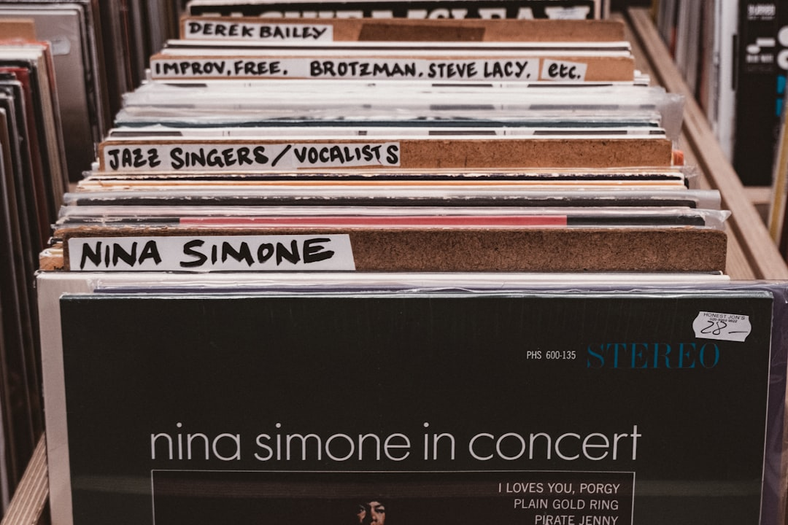

If you run a vintage HiFi system, jazz is a natural fit for it. The genre's dynamic range, instrumental interplay, and often sparse recording approach make differences in a system and in a pressing easier to notice. Finding the best sounding jazz records is partly about the music and partly about which recordings and pressings were made with care. This guide explains how to choose, which Blue Note-focused reissue series are worth researching, and which setup and care steps affect playback.

**A note on method:** this article does not report listening tests. The albums and series named here are drawn from widely documented recording credits and published reissue details. Sound quality is subjective and varies by pressing, system, and room, so treat every sonic description below as a general expectation, not a measured result. Verify details against the label's own release notes before buying.

Photo by <a href="https://unsplash.com/@reganography">Samuel Regan-Asante</a> on <a href="https://unsplash.com/">Unsplash</a>

## Why Jazz Is a Revealing Test for Vintage HiFi

Jazz is largely an acoustic art form, and many classic recordings were made with few microphones in a single room. That tends to preserve dynamics, timbre, and a sense of placement: saxophone breath, brushwork on a snare, the body of an upright bass. Quiet passages matter as much as loud ones, so a system that handles both without strain or harshness is easier to judge with this music.

Recordings like these often keep more dynamic contrast than heavily compressed modern releases, though that varies by title. Good playback depends on the whole chain: a properly aligned turntable and cartridge, a phono stage matched to that cartridge, an amplifier with enough headroom for your speakers, and a room that does not smear the image. Specific vintage models are often praised for these traits, but this article has no measurements for any particular unit, so check the specifications and condition of your own equipment.

## Selecting Jazz Records: A Transparent Method

Without listening notes to draw on, a documented selection method is more useful than a ranking. These criteria rely on information you can check yourself:

1. **Recording credits.** Look up the recording engineer and studio. Rudy Van Gelder recorded a large share of Blue Note and Prestige sessions, first in his parents' home in Hackensack, New Jersey, and later at his studio in Englewood Cliffs.
2. **Mastering source.** Prefer reissues that state they were mastered from the original analog tapes, and check who did the mastering.
3. **Pressing plant and vinyl.** Release notes or the runout groove often identify the plant. Plant and vinyl quality affect surface noise and flatness.
4. **Condition.** A clean, flat copy of a modest pressing usually plays better than a worn copy of a prized one.
5. **Community consensus.** Forum threads and pressing databases, such as the [Steve Hoffman Music Forums](https://forums.stevehoffman.tv/forums/audio-hardware.5/), collect pressing-by-pressing opinions. These are other listeners' impressions, not verified results.

## Iconic Labels and Recordings Worth Researching

The 1950s and 60s were a rich period for jazz recording, and several labels are known for it.

- **Blue Note.** Albums such as John Coltrane's *Blue Train* and Horace Silver's *Song for My Father* are often cited for both music and recorded sound. Van Gelder is generally credited as engineer on much of the label's catalog, but credits differ by album, so check the specific title. For example, Art Blakey & The Jazz Messengers' *Moanin'* is often discussed alongside the Van Gelder sessions, but it should be checked individually.
- **Prestige.** Sonny Rollins' *Saxophone Colossus* is a frequently mentioned title, and Van Gelder is credited on many Prestige sessions.
- **Riverside.** Bill Evans' *Waltz for Debby* and *Sunday at the Village Vanguard* are live club recordings that are widely discussed for their intimate atmosphere.
- **Verve.** Norman Granz produced Ella Fitzgerald's Songbook series for the label.
- **Impulse!** John Coltrane's *A Love Supreme* is a standard reference title from this label.

Original pressings of these albums are often expensive, and records of that age commonly have surface noise, groove wear, or warps. Claims that specific first pressings are sonically superior come up often in collector discussion, but this article has no comparison data to confirm them. Reissues are a practical alternative for many listeners, and the quality of a reissue depends on its source tape, mastering, and pressing.

## Jazz Reissue Series: What to Check

As an Amazon Associate, I earn from qualifying purchases.

Two reissue series centered on the Blue Note catalog are frequently discussed. The details below reflect commonly published information and may vary by title and batch, so confirm them on the specific release.

The **Music Matters Blue Note 45 RPM Jazz Reissues** ([Music Matters Blue Note 45 RPM Jazz Reissues](https://www.amazon.com/dp/B076GYXN7Y?tag=analogrevivalist-20)) are generally described as mastered from the original analog tapes, pressed on 180-gram vinyl at RTI, and spread over two 45 RPM discs for most titles. Kevin Gray and Steve Hoffman are the names usually associated with the series. A higher disc speed is intended to give the cutting process more room, which proponents say benefits dynamics and high-frequency detail. Titles in the series have included Jackie McLean's *Destination... Out!* and Lee Morgan's *The Sidewinder*. These sets typically cost more than single-disc reissues, and the two-disc format means more record changes during a listening session.

The **Blue Note Classic Vinyl Series Jazz Pressings** ([Blue Note Classic Vinyl Series Jazz Pressings](https://www.amazon.com/dp/B07BKHLT3R?tag=analogrevivalist-20)) are single-LP, 33 1/3 RPM reissues. They are commonly described as mastered from analog tapes by Kevin Gray, with pressing at more than one plant depending on the batch. Titles have included Herbie Hancock's *Maiden Voyage* and Wayne Shorter's *Speak No Evil*. They usually sit at a lower price than the 45 RPM sets. How they compare in sound is a matter of listener opinion, and this article does not rank them.

Other labels, including Acoustic Sounds, Analogue Productions, and Craft Recordings, also reissue jazz catalogs. For any of them, the same checks apply. For more on finding records in good condition, see [How to Buy Used Vinyl](/2026/03/14/how-to-buy-used-vinyl/).

### What to Compare Between Reissues

| Question | Where to look |
| :--- | :--- |
| What was the source: original analog tape or a digital transfer? | Label or distributor release notes, sticker on the shrink wrap |
| Who mastered or cut it? | Jacket credits, runout-groove etchings |
| Which pressing plant made it? | Release notes, runout markings, pressing databases |
| 33 1/3 or 45 RPM, and how many discs? | Product listing |
| What condition is the specific copy? | Seller photos and grading, or your own inspection |
| What do other listeners report about this exact title? | Forum threads and pressing databases (treat as opinion) |

A reissue that answers these questions well is usually a better bet than one that does not, but none of these factors guarantees a particular sound.

## Turntable Setup for Jazz

Playback quality depends heavily on setup. Follow the manufacturer's instructions for your tonearm and cartridge, and treat the points below as general guidance.

- **Tracking force.** Set it within the cartridge manufacturer's recommended range, ideally with a stylus force gauge. Too little can cause mistracking, and too much adds wear. Check your cartridge's datasheet for the range; do not rely on a figure from memory.
- **Vertical tracking angle (VTA) and stylus rake angle (SRA).** Tonearm height affects the angle at which the stylus meets the groove. Small changes can shift tonal balance, and record thickness can change the optimum slightly. Not every vintage turntable offers VTA adjustment, and some need shims or an aftermarket adjuster.
- **Azimuth.** The cartridge should sit square to the record surface. Poor azimuth can cause channel imbalance and reduced separation. A test record or a protractor-style tool can help you check it.
- **Anti-skate.** This counteracts the inward pull on the tonearm. Set it according to the tonearm manual, and verify with a test record if you have one.
- **Cartridge and phono stage matching.** Moving coil cartridges generally need more gain and may need specific loading. Moving magnet cartridges generally need a specific input capacitance. Match both to the cartridge's published specifications. See [MM vs MC Cartridges Compared](/2026/03/11/mm-vs-mc-cartridges/) for background.

Internal repairs or modifications to vintage amplifiers and receivers, such as recapping, involve stored electrical energy and should be handled by a qualified technician. Setup adjustments on the turntable and cartridge described here do not require opening any equipment.

## Record Care for Jazz Collectors

Dust, grime, static, and fingerprints add noise and can accelerate wear.

- **Storage.** Store records vertically, in anti-static, poly-lined inner sleeves, with outer sleeves to protect jackets. Handle records by the edges and label.
- **Before each play.** A carbon fiber brush removes loose dust. An anti-static tool or cloth can help if static is a problem.
- **Deeper cleaning.** For used records with visible grime, wet cleaning is commonly recommended. Dedicated record cleaning machines apply fluid and then vacuum it away, and many collectors consider them worthwhile. This article does not review or recommend a specific machine.
- **Stylus care.** The linked [Audio-Technica AT60VL Stylus Cleaner](https://www.amazon.com/dp/B00IO8CCWY?tag=analogrevivalist-20) is a stylus-cleaning accessory, not a record-cleaning machine. Cleaning the stylus regularly is a separate step from cleaning records. This article has not tested the product, so check the manufacturer's instructions and user reviews before using it.

## Common Mistakes to Avoid

1. **Setting only tracking force.** VTA, azimuth, and anti-skate also affect balance, imaging, and distortion. A setup protractor, a stylus force gauge, and a test record are useful tools.
2. **Skipping record cleaning and proper storage.** Dirt can add noise and contribute to groove wear. Horizontal stacking can contribute to warping.
3. **Mismatching cartridge and phono stage loading.** Using the wrong input impedance or capacitance can change the frequency response. Check the cartridge's specifications, and use a phono stage with adjustable loading if your cartridge requires it.
4. **Assuming all reissues are equal.** Quality varies with source, mastering, and pressing. Research the specific release rather than relying on a series name or marketing language.
5. **Overlooking room acoustics.** Reflective surfaces and speaker placement can affect imaging and bass. Rugs, curtains, and moving speakers relative to walls are low-cost places to start.

## Frequently Asked Questions

### Why do jazz records often work well on vintage systems?

Many 1950s and 60s jazz sessions were recorded with a small number of microphones and limited processing, which tends to preserve dynamics and the spatial relationship between instruments. Systems that reproduce dynamics and timbre cleanly can make that apparent. Results depend on the individual recording, equipment condition, and room, and this is a general observation, not a tested claim.

### What's the difference between mono and stereo jazz recordings?

Early jazz recordings were mono. Stereo arrived in the late 1950s, and early stereo mixes sometimes placed instruments hard left and right, which some listeners find artificial. Later stereo recordings often spread instruments more naturally. Mono records have a centered, focused presentation, and stereo records provide width and depth. Which you prefer depends on personal taste and the specific title. Mono records should be played with a cartridge and stylus suited to them; check the cartridge manufacturer's guidance for older mono pressings.

### Are all jazz reissues created equal?

No. Three factors are commonly cited: the source material (original analog tape versus a digital copy), the mastering engineer, and the pressing plant. A reissue's source and credits are often documented, but they do not guarantee a particular sound. Check the release notes for the specific title.

## Conclusion

Choosing the best sounding jazz records is a matter of checking documented details: recording credits, mastering source, pressing plant, and condition. Blue Note-focused reissue series such as Music Matters and the Blue Note Classic Vinyl Series are reasonable places to start your research, and a careful turntable setup and clean records matter as much as the pressing. This article offers no listening tests or measurements, so use it as a research guide and trust your own ears and system when you decide.

### Related Reading

*   [How to Buy Used Vinyl](/2026/03/14/how-to-buy-used-vinyl/)
*   [Beginner Guide to Vintage HiFi](/2026/03/11/beginners-guide-to-vintage-hifi/)

  
<strong>About the Author</strong>

  
The Analog Revivalist team writes about vintage audio and analog playback. Articles summarize publicly available information and manufacturer documentation; unless an article says otherwise, it does not report first-hand testing.

