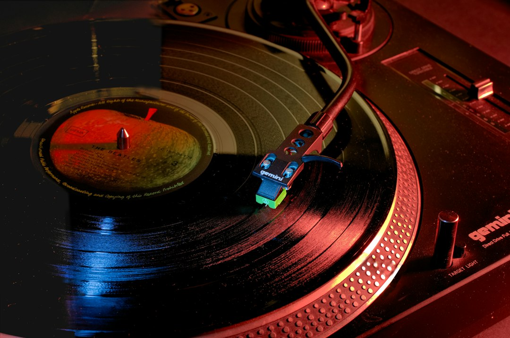

Most turntable troubleshooting starts with a vague complaint. The sound is "a bit harsh," one speaker seems "weaker," or the bass feels "loose." You then change three things at once, play a favorite album, and decide it feels better. A week later you can't say what you fixed or whether you fixed anything.

A test record replaces that guesswork with a repeatable signal. A good one contains tracks designed to expose specific problems: swapped or inverted channels, tracking trouble, excess rumble, speed instability, and resonance in the tonearm and cartridge. Played the same way every time, it gives you a consistent reference you can compare against later.

My position is simple. A test record is a diagnostic aid, not an oracle. It narrows the field and tells you which setting or component deserves attention first. It will not rank your system, and it will not tell you which repair to buy. Used with a written log and a conservative hand, it is one of the most cost-effective tools in vintage hifi. Used carelessly, it wastes a stylus.

Photo by <a href="https://unsplash.com/@tinkerman?utm_source=artlines_blog&utm_medium=referral">Immo Wegmann</a> on <a href="https://unsplash.com/?utm_source=artlines_blog&utm_medium=referral">Unsplash</a>

## What test records can and cannot tell you about your turntable system

A test record is a pressing of known signals: tones, sweeps, announced channel checks, and modulated grooves with defined difficulty. Because the content is known, any departure from what the liner notes describe points to something in the playback chain. The chain includes the cartridge, tonearm, turntable, phono stage, amplifier, speakers, and room.

That last sentence is also the limit. A test record cannot tell you which link caused a problem unless you design the check to isolate it. A buzz on a loud passage might come from the stylus, from an overloaded phono stage, or from a rattling shelf. The record gives you a repeatable symptom. The reasoning is still yours.

### What the tracks are generally designed to reveal

Test records vary by title and publisher, so always follow the documentation that comes with yours. Common categories include:

- **Channel identification and phase.** Announcements or tones confirm that left is left and right is right, and that both channels move in the same polarity. This catches reversed speaker wires or a miswired cartridge lead.
- **Tracking and distortion tracks.** Grooves with increasing modulation challenge how well the stylus stays in contact. Buzzing, grit, or a sudden harshness at a particular level suggests tracking trouble.
- **Anti-skate and channel balance checks.** Some records include tracks meant to help you see whether the stylus is pulled more heavily against one groove wall.
- **Frequency sweeps and resonance.** A sweep shows how the system responds across the band and can expose a resonance in the low end, often tied to the interaction of tonearm mass and cartridge compliance.
- **Speed stability tones.** A steady tone makes drift and wobble easier to hear. Some tones are intended for use with measuring equipment, which you do not need for a basic check.
- **Quiet or blank grooves.** These help you listen for rumble, hum, and noise floor without music masking them.

### What they cannot do

They cannot certify that your system is "correct," and they will not replace a proper setup. They also do not tell you whether a used turntable is safe to keep powered on. If a deck sounds or behaves in a way that suggests an electrical or mechanical fault, stop and use the guidance in our [turntable troubleshooting guide for decks that will not spin or run at the wrong speed](/2026/08/17/how-to-troubleshoot-a-turntable-that-won-t-spin-or-runs-at-the-wrong-speed/). Do not open the equipment as part of test-record work. This guide covers listening checks only.

## Choosing and preparing test records

Several test records have circulated among hobbyists over the decades. Examples include the Hi-Fi News test record, various Ortofon test pressings, the Shure Audio Obstacle Course record, and Analogue Productions' Ultimate Analogue Test LP. Availability and reissue status change, and original pressings vary in condition, so treat this as a list of names to research, not a shopping recommendation. The practical rule is to choose a record whose track-by-track documentation you can actually obtain. A test record without its liner notes is just a record of strange noises.

### Prefer clean, documented copies

Before you buy a used test record, apply the same inspection habits you would use for any used LP. Check the surfaces for scratches and the sleeve for ring wear, and confirm that the insert or booklet is included. Our guide on [how to buy used vinyl](/2026/03/14/how-to-buy-used-vinyl/) covers the visual inspection steps. A damaged test record produces false symptoms. A scratch in a tracking test track looks exactly like a tracking failure.

### Prepare the record and the stylus first

Clean the record using the method in [how to clean vinyl records](/2026/03/11/how-to-clean-vinyl-records/) and inspect the stylus using [how to clean a turntable stylus](/2026/03/11/how-to-clean-turntable-stylus/). A dirty stylus can mimic distortion, and dust in the groove can mimic noise. Cleaning first removes two easy false alarms before you start.

For storage and handling, the Library of Congress publishes general guidance on caring for audio discs at [loc.gov/preservation/care](https://www.loc.gov/preservation/care/record.html). The core points are to handle records by the edges and label, keep them vertical, and avoid heat and sunlight. A test record you play only occasionally should still be stored properly, because a warped or contaminated copy will mislead you.

### Know your own equipment documentation

Cartridge and turntable makers publish setup values and general support material. Manufacturers such as [Audio-Technica](https://www.audio-technica.com/en-us/support) and [Shure](https://www.shure.com/en-US/support) maintain support sections where you can look for manuals and setup information. Use them to find the recommended tracking force range for your specific cartridge, then write that range in your log before you test. Do not rely on a number remembered from a forum thread.

## Step-by-step: running test records through your turntable system

Run the same sequence each time. Consistency is what makes the results comparable across weeks or after a change. Keep the volume moderate throughout. Test tracks with strong modulation, sweeps, or tones can be unpleasantly loud or can stress speakers if you turn them up.

1. **Set the baseline and write it down.** Confirm the turntable sits level, the platter and mat are seated, and the tonearm settings match the cartridge documentation. Our guide to [setting tracking force and anti-skate](/2026/03/11/setting-tracking-force-anti-skate/) walks through the adjustments. Record the values in your log before playing anything.
2. **Clean the record and stylus.** Do this every session. It removes variables and protects the groove.
3. **Do the channel and phase check first.** Play the identification track and confirm each channel reproduces from the correct speaker. Then play the phase track and listen for the behavior the liner notes describe. If channels are swapped or out of phase, check external connections only: speaker wire polarity, interconnect orientation, and cartridge-lead connections visible from outside. Do not open any casework.
4. **Listen to the quiet grooves.** With the music stopped, listen at your normal listening volume with the amplifier set as usual. Note any hum, buzz, or low rumble, and whether it changes when you raise the volume or touch the amplifier's input selector. If hum is the main issue, switch to our guide on [diagnosing hum in a vintage hifi system](/2026/04/16/how-to-diagnose-hum-vintage-hifi-system/).
5. **Play the tracking tracks conservatively.** Start at the easiest level and work upward only while the sound stays clean. Stop when you hear sustained distortion. Do not keep replaying the hardest track, because repeated passes add wear to both the stylus and the groove.
6. **Check speed stability with a sustained tone.** Play the steady-tone track and listen for wobble, drift, or a pitch that sags over the course of the track. If you hear a problem, note which part of the record it happens on, since an off-center pressing or a warp can create a similar effect.
7. **Run the sweep and listen for resonance.** Keep the volume low. Listen for a region where the low end swells or the arm seems to rock. Note the approximate point in the track, not a frequency you cannot verify.
8. **Write the results immediately.** Record what you heard in plain language, along with the changes you made. Your memory will blur within a day.
9. **Change one thing, then repeat.** If you adjust tracking force, retest only the affected tracks. If you change multiple settings, you lose the ability to say which one mattered.

A session like this takes about an hour, including setup. Rushing it defeats the purpose.

## Reading the results: from symptom to next check

The table below maps common symptoms to sensible next checks. It is a decision aid, not a diagnosis. Each row lists likely areas to inspect first, but a symptom can have several causes.

| What you hear | Possible areas to check first | What to avoid |
|---|---|---|
| Left and right appear reversed | Speaker cable connections, interconnect orientation, cartridge leads from outside | Opening equipment to trace wiring |
| Phase track sounds hollow or oddly diffuse | Speaker wire polarity on one side | Assuming the record is defective before checking polarity |
| Grit or buzz on loud tracking tracks | Tracking force against the documented range, stylus cleanliness, stylus wear, alignment | Raising force far above the maker's range |
| Distortion on one channel only | Anti-skate setting, alignment, cable connections, stylus condition | Adjusting multiple settings at once |
| Steady tone wobbles or drifts | Record warp or off-center hole, belt or drive condition, platter seating | Opening the turntable or adjusting internal speed controls |
| Low-frequency swell during sweep | Isolation and shelf stability, tonearm and cartridge pairing | Assuming a fault before checking the shelf |
| Constant hum in quiet grooves | Grounding connection, cable routing, phono stage placement | Swapping several cables at once |
| Noise that tracks with the record, not the system | Record cleanliness, surface damage | Blaming the cartridge first |

### A simple decision framework

When the results are unclear, ask three questions in order.

**First, does the symptom follow the record?** Play a different clean record. If the problem disappears, suspect the first record's surface or pressing.

**Second, does the symptom follow the channel?** If one channel is affected, swap the external speaker connections at the speaker terminals only if you can do so safely with the amplifier off. If the problem moves to the other speaker, the cause is likely upstream of the speaker. If it stays, look at the speaker or its wiring.

**Third, does the symptom change with a single adjustment?** If you change one setting and the result improves, you have a lead. If nothing changes, return the setting to its documented value and move to the next area.

For cartridge alignment symptoms, use [how to align a phono cartridge](/2026/06/08/how-to-align-a-phono-cartridge-vta-azimuth-overhang/) as the next step. For a complete restart from known-good settings, see our guide on [setting up and calibrating a turntable from scratch](/2026/05/18/2026-05-18-how-to-set-up-and-calibrate-a-turntable-from-scratch/).

## A test records decision log you can copy

A log is the most valuable thing you will build from this exercise. Copy the structure below into a notebook or spreadsheet. It is an original worksheet, so adapt it freely.

**Session header**

| Field | Your entry |
|---|---|
| Date | |
| Turntable and cartridge (as labeled externally) | |
| Documented tracking force range (from maker's manual) | |
| Tracking force and anti-skate set today | |
| Phono stage, amplifier, and speakers used | |
| Test record title and pressing details | |
| Record and stylus cleaned before session (yes/no) | |

**Check results**

| Check | What I heard (plain language) | Pass, concern, or unsure | Change made | Retest result |
|---|---|---|---|---|
| Channel identification | | | | |
| Phase check | | | | |
| Quiet grooves | | | | |
| Tracking tracks (highest clean level reached) | | | | |
| Speed stability tone | | | | |
| Sweep or resonance | | | | |

**Decision rule**

Use these rules to decide what happens next:

- **Pass on everything:** Leave settings alone. Note the date as your baseline and retest after any hardware change.
- **One concern:** Change one thing, retest, and log it.
- **Two or more concerns in different areas:** Return to documented setup values and work through the problems one at a time, starting with whichever is easiest to fix.
- **Any sign of a mechanical or electrical fault:** Stop using the equipment and have it looked at by a qualified technician.

### Illustrative example, not an observation

To show how entries should look, here is a hypothetical log line: "Tracking track, level 3: slight grit on the right channel. Stylus cleaned. Retest: grit remains. Check alignment next." This is an invented example for formatting purposes. It does not describe a test of any real system, and the level numbers are placeholders. Your own record's documentation defines what its levels mean.

## Common mistakes and problems when using test records

Most disappointing test-record sessions come from the process, not the equipment. These are the errors worth avoiding.

**Playing the hardest track repeatedly.** High-modulation tracks stress the stylus and groove. Play them once or twice, and stop if the sound degrades. A test record is not a demo disc to replay for fun.

**Skipping the documentation.** Track names and levels differ between records. If you guess what a track is for, your conclusions will be unreliable. Read the liner notes before playing, not after.

**Changing several settings at once.** If you adjust tracking force, anti-skate, and cartridge height in one sitting, you cannot tell which change helped. Make one change per retest.

**Using a dirty or damaged record.** A scratch, a fingerprint, or accumulated dust can produce symptoms that look like system faults. Clean first, and check a second record when something sounds wrong.

**Ignoring the manufacturer's range.** Pushing tracking force above the documented range to quiet a distortion can accelerate wear. Use the maker's support materials to confirm the range before experimenting.

**Treating the room as invisible.** Resonances can come from a wobbly shelf, a nearby cabinet, or a floor that transmits footsteps. If a low-frequency symptom changes when you move or isolate the turntable, the system may be fine. Our guide on [turntable isolation and vibration control on a budget](/2026/05/06/2026-05-06-turntable-isolation-and-vibration-control-on-a-budget/) covers that side.

**Opening equipment to chase a symptom.** A test record shows what you can hear. It does not authorize internal inspection or electrical testing. Keep the work to external settings, cleaning, and listening. If the results suggest a deeper fault, hand it to a qualified technician.

**Trusting memory.** Without a log, you will remember the dramatic moments and forget the baseline. Write results immediately, with the date.

**Expecting a number.** Some test-record content is meant for measuring equipment. Without it, you are making a listening judgment, and your notes should say so. Record "sounded steady" or "sounded unsteady," not a precise percentage you did not measure.

## FAQ

### Do I need a test record if my turntable already sounds fine?

Not necessarily, but one is useful as a baseline. A system that sounds fine today may drift as a stylus wears or a belt ages, and a logged test session gives you something concrete to compare against. If you are happy and nothing has changed, you can skip it. If you have just bought a used deck, replaced a cartridge, or moved the system, a short session is a reasonable way to confirm that basic channel, phase, and tracking behavior are sound before you trust the setup with your collection.

### Can a test record damage my stylus or my records?

Any play adds wear, and tracks with strong modulation or sustained tones place more demand on the stylus than typical music. The risk is manageable if you use the hard tracks sparingly, keep tracking force within the maker's documented range, and clean the stylus and record first. The main way to cause avoidable harm is to repeat the toughest tracks or to raise tracking force well beyond the documented range hoping to cure a symptom. Treat the record as a measured tool, not a regular listening disc.

### Which test record should I buy first?

Choose based on documentation and condition, not reputation alone. Look for a record whose track listing and instructions you can read, and whose surfaces are clean. Titles such as the Hi-Fi News test record, Ortofon test pressings, the Shure Obstacle Course, and the Ultimate Analogue Test LP are commonly discussed, but availability and quality vary by pressing. Research what each includes, confirm that the contents match your needs, and avoid paying a collector premium for a rare copy when a clean, documented one will do the job.

### What should I do if the results suggest a hardware fault?

Stop testing and return settings to the documented values. If the symptom involves unusual noise, heat, smell, an unsteady platter, or anything that suggests an electrical problem, power the equipment down and have it examined by a qualified technician. Do not open the casework or attempt internal electrical checks yourself based on a test-record result. Share your log with the technician. A dated record of what you heard and what you changed will save diagnostic time and help them focus on the right area.

## Conclusion

Test records turn a vague impression into a structured listening check. Their value comes from consistency: the same record, the same sequence, the same log, and one change at a time. Start with channel and phase, listen to the quiet grooves, approach the tracking tracks conservatively, and write down what you hear while it is fresh.

Your next action is small. Find the documented tracking force range for your cartridge in the maker's support materials, copy the log from this guide, and run a first baseline session on a clean record with a clean stylus. Then retest only when something changes. That habit will tell you more about your system than any single audition.

If this guide helped, bookmark it for your next setup session or leave a comment with the symptom you are chasing.

**Related reading**

- [How to set up and calibrate a turntable from scratch](/2026/05/18/2026-05-18-how-to-set-up-and-calibrate-a-turntable-from-scratch/)
- [How to diagnose hum in a vintage hifi system](/2026/04/16/how-to-diagnose-hum-vintage-hifi-system/)

  
<strong>About the Author</strong>

  
The Analog Revivalist team researches vintage audio restoration, drawing on service manual documentation, technician community knowledge, and comparative equipment reviews. Our guides focus on what the evidence supports - not just received wisdom.

