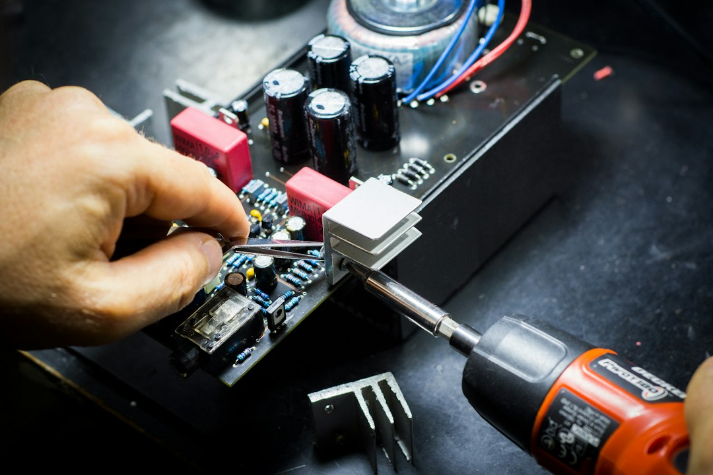

A vintage receiver can change hands three times in ten years and reach the next owner with nothing but a faded sticker and a story. The story usually sounds like "recently serviced, works great." Recently by whom? Serviced how? Nobody remembers, and the receipt, if one ever existed, left with the packaging.

A maintenance and repair history log fixes that. It is a plain document, a spreadsheet or a notebook page, that records what a piece of gear is, what condition it arrived in, what the seller claimed, what you can actually prove, and what any technician did afterward. It will not make equipment sound better. It makes your decisions better: whether to pay an asking price, whether a symptom is new or old, whether a quote is reasonable, and what you can honestly tell the next buyer.

My position is simple. Keep one log per component, start it the day the gear arrives, and keep claims and proof in separate columns. This guide shows how, with a worksheet you can copy. It is a documentation guide only. It does not teach you to open, test, or repair equipment, and nothing here should be read as a repair procedure.

Photo by <a href="https://unsplash.com/@www_erzetich_com?utm_source=artlines_blog&utm_medium=referral">Blaz Erzetic</a> on <a href="https://unsplash.com/?utm_source=artlines_blog&utm_medium=referral">Unsplash</a>

## Why a maintenance and repair history log matters

Vintage audio gear outlives its paperwork. Forty or fifty years is long enough for a component to pass through several households, a couple of repair shops, and at least one basement flood story. Without a record, every symptom starts from zero. A channel that cuts out intermittently is a very different problem if the log shows the same complaint three years ago than if it appeared last week.

The practical benefits are concrete:

- **Better conversations with technicians.** A dated list of symptoms, when they appear, and what changed beforehand is more useful than "it sounds off." Technicians still diagnose the unit themselves, but good notes shorten the intake conversation.
- **Defensible resale.** A buyer cannot verify "serviced" on your word alone. A log that points to an invoice, with the shop name and date, is a stronger listing than an adjective.
- **Honest purchase decisions.** Writing down what a seller claimed, separate from what you verified, protects you from your own optimism. Our guide to [identifying and avoiding vintage audio scams at thrift stores](/2026/05/20/2026-05-20-identifying-and-avoiding-vintage-audio-scams-at-thrift-stores/) covers why that separation matters at the point of sale.
- **Pattern recognition.** Across a collection, the log shows which pieces keep returning to the bench and which have been quiet for years. That informs what you buy next.

None of this requires special software. A shared spreadsheet, a binder, or a folder of text files all work. What matters is that you actually write things down at the time they happen, because memory edits itself within weeks.

## What to record: identity, condition, claims, and service events

Think of the log as four layers, each answering a different question. Keep them visually distinct so that a reader can tell fact from hearsay at a glance.

### Layer one: identity

Record the make, model name, model number as printed on the unit, and serial number exactly as it appears, including letters, dashes, and any prefix. Add the date and source of acquisition, the price paid, and the format of any listing or receipt. If a rear-panel label lists a voltage rating or region, copy it as written rather than interpreting it. Interpretation belongs in a separate notes column labeled as your reading, not the unit's statement.

### Layer two: external condition

Document only what you can see and handle from the outside without opening anything. Useful items include cabinet or plinth finish, veneer lifting, dust cover cracks, missing feet, knob mismatches, scratches on the faceplate, rust on screws or jacks, evidence of previous repairs visible from outside (different screw types, tool marks, paint on fasteners), and any smell you notice when it arrives. Describe, do not diagnose. "Slight crackle noted on volume knob rotation at arrival" is an observation. "Dirty pot" is a guess. If you hear or smell something concerning, such as a hot or burning odor, stop using the unit and take it to a qualified technician rather than investigating.

### Layer three: seller claims versus verified receipts

This is the layer most owners skip, and it matters most. Use two separate fields:

- **Claimed:** exactly what the seller said, with the date and where they said it (listing text, message, conversation). Quote it.
- **Verified:** what you hold documentary evidence for, such as an invoice from a named shop with a date, a manual that matches the model, or a photograph that contradicts or confirms a claim.

"Recapped last year" in a listing is a claim until an invoice from a named technician backs it up. Our post on [documenting a used hifi purchase](/2026/11/05/documenting-a-used-hifi-purchase-serial-numbers-condition-photos-and-service-rec/) goes deeper on collecting that evidence at purchase time, and the log is where it lives long term.

### Layer four: service and maintenance events

Every event gets a dated row: what prompted it, who performed it (you or a named shop), what the invoice says was done, the cost, and any stated warranty. For things you do yourself on the outside of equipment, such as wiping a faceplate, cleaning a stylus, or relocating a rack, note the date and what you used. For example, if you follow our [turntable stylus cleaning guide](/2026/03/11/how-to-clean-turntable-stylus/), log the date so you can track stylus hours against your cartridge manufacturer's guidance.

### Photographing serial labels with privacy in mind

Photographs are the most durable evidence in the log, and serial labels are the anchor. Shoot the label straight on with even light, then a wider shot showing the label's location on the unit. Take photos of the front, back, both sides, and the top, plus close-ups of any damage.

Privacy needs a little thought, because the photos will travel: to technicians, to buyers, to forums where people help identify gear. Consider these points:

- **Strip location metadata.** Phone photos often embed GPS coordinates in their EXIF data. Most phones and photo apps can remove location data when sharing, and it is worth checking that setting before you post anything publicly.
- **Watch the background.** Shipping labels, mail, house numbers, and window views can reveal your address. Shoot against a plain surface.
- **Serial numbers are not secrets, but treat them with care.** A serial on its own rarely identifies you. Combined with a seller's name, your address, or a receipt, it builds a profile. Share the label photo when asked for identification and keep receipts out of public posts.
- **Redact receipts.** Black out card digits, order numbers, and addresses before sharing a copy. Keep the unredacted original in your private archive.

## How to build a maintenance and repair history log in seven steps

Here is the process I recommend for each new piece of gear. It works equally well for a collection you already own, just starting from today instead of from the purchase date.

1. **Create one record per component, not one per household.** A receiver, a turntable, and a tape deck each get their own log, even if you keep them in one workbook with separate tabs. Name the file or tab with make, model, and the last four characters of the serial so duplicates of the same model stay distinguishable.
2. **Record identity fields on arrival day.** Copy the model and serial exactly, note the date, the source, and the price. Do it before the gear is set up. Details get lost fast once the unit is part of your system.
3. **Photograph the exterior and the labels.** Shoot all sides, the label, and any flaws, using the privacy practices above. Store the original files and note the filenames in the log.
4. **Enter seller claims verbatim, then enter proof separately.** Paste the listing text or message. In the verified column, add only what you hold documents for. Leave it blank otherwise; a blank is useful information.
5. **Look up the manufacturer documentation and note its source.** Find the owner's or service manual for the exact model and record where you found it and the revision or date if shown. The manufacturer's support page is the best starting point; see the manuals section below. Our guide on [how to read a vintage audio service manual](/2026/07/29/how-to-read-a-vintage-audio-service-manual-what-the-specs-mean-and-how-to-use-th/) explains what you are looking at once you have one.
6. **Log every event the day it happens.** That includes symptoms noticed, shop drop-offs, quotes, approvals, pickups, and any exterior cleaning you do. Add a line even when nothing was fixed; "no fault found" is a legitimate result worth recording.
7. **Review and back up on a schedule.** Once a quarter, skim each log for gaps such as an invoice you never scanned or a symptom you never followed up. Then confirm your backup copy opens.

For step 5, general manual lookup starts at the maker. For example, [Audio-Technica's support site](https://www.audio-technica.com/en-us/support) hosts documentation for its current and some past products, and other major brands run similar pages. Not every vintage model is covered, and older brands may have changed hands or folded, so treat a missing manual as a gap to log, not as a dead end. Whatever you find, confirm the document matches your model number before relying on it.

## A worksheet you can copy

Below is an original worksheet layout. Copy it into a spreadsheet or notebook. The first table is the permanent identity record; the second is the running event log.

**Identity and condition record**

| Field | What to write | Source type |
|---|---|---|
| Make and model | As printed on the unit | Observed |
| Serial number | Exactly as on the label | Observed (photo filename) |
| Acquired (date, source, price) | Seller or venue, amount paid | Receipt or message |
| Exterior condition at arrival | Short factual description | Observed |
| Seller claim (verbatim) | Quote with date | Claimed |
| Verified evidence | Invoice, manual, photo | Verified |
| Manual source | Link or file location | Documented |
| Storage location of records | Folder or binder name | Admin |

**Event log**

| Date | Event type | Symptom or reason | Who | Invoice or note location | Cost | Follow-up due |
|---|---|---|---|---|---|---|
| (date) | Symptom / Drop-off / Quote / Pickup / Exterior care | Describe plainly | You or named shop | File name | Amount | Date or none |

**Illustrative example only.** The row below is invented to show format. It is not an observation about any real unit or shop.

| Date | Event type | Symptom or reason | Who | Invoice or note location | Cost | Follow-up due |
|---|---|---|---|---|---|---|
| 2026-02-10 | Drop-off | Left channel drops out after warm-up; noticed twice in one week | Example Audio Repair | invoices/example-2026-02-10.pdf | Quote pending | Call 2026-02-17 |

### A simple decision log for "bench or keep listening"

Use this second small framework when something changes. It keeps you from either ignoring a problem or panicking. It does not diagnose anything; it only decides what to write down and whom to ask.

| What you notice | Log it as | Next step |
|---|---|---|
| Smell of overheating, smoke, visible sparking, or a shock | Safety event, stop use | Unplug if you can do so safely, then contact a qualified technician. Do not investigate yourself. |
| Intermittent sound change | Symptom with date and conditions | Note what was playing and for how long; consider a technician visit if it repeats |
| Cosmetic wear only | Condition note | Photograph; no technician needed |
| Behavior differs from the manual's description | Symptom with page reference | Ask the manufacturer or a technician before adjusting anything |

Our posts on [diagnosing hum in a vintage hifi system](/2026/04/16/how-to-diagnose-hum-vintage-hifi-system/) and [using test records to evaluate your turntable system](/2026/11/15/how-to-use-test-records-to-evaluate-and-troubleshoot-your-turntable-system/) show how to describe listening symptoms in terms a technician can act on.

## Service invoice questions and safe storage of records

An invoice is the most valuable document your log will point to, but only if it says something. "Serviced, $120" tells a future buyer almost nothing. Before you pay, ask the shop to itemize. Reasonable questions include:

- What symptoms did you find, and what did you do about each?
- Which parts were replaced, and were they original-spec or substitutes?
- Which items did you check but leave alone?
- Is the work covered by a warranty, for how long, and what voids it?
- Did you notice anything else that may need attention later?
- Can the invoice include the model and serial number?

Shops differ in how detailed they get, and a small business may not produce paperwork you would expect from a manufacturer. Ask politely, and log the answer either way. If a shop gives only a verbal summary, write it down the same day and mark it as "verbal, not documented" in the verified column.

For more extensive work such as the capacitor replacement covered in our post on [recapping a vintage amplifier or receiver](/2026/04/20/how-to-recap-a-vintage-amplifier-or-receiver/), the itemized invoice is what turns "recapped" from a claim into a verifiable fact. That is work for a qualified technician; this log simply records the outcome.

### Keeping the records safe

Paper and files both fail, so plan for each. Scan paper invoices at a readable resolution and name the files with date, shop, and model, such as `2026-02-10_example-audio_receiver-model.pdf`. Guidance from the Library of Congress on [personal digital archiving](https://www.digitalpreservation.gov/personalarchiving/records.html) generally recommends identifying what is important, keeping copies in more than one place, and checking them periodically; those habits map directly onto a gear log.

A workable arrangement is one working copy on your computer, one backup on an external drive or cloud service you trust, and originals of paper invoices kept flat and dry, away from the humidity that can warp records and damage paper alike. See our note on [storing vinyl to prevent warping](/2026/03/28/how-to-store-vinyl-records-prevent-warping/) for a similar storage logic. Keep a separate private folder for unredacted receipts, and create a shareable folder with redacted versions you can send to buyers or technicians.

It is also worth checking public safety notices when you acquire older products. The U.S. Consumer Product Safety Commission publishes a searchable [recalls database](https://www.cpsc.gov/Recalls), and a note in your log saying "checked, no recall found on date" is more useful than silence. A search can only report what has been published, so treat a clean result as one data point, not a clearance.

## Common mistakes that make a repair history log useless

Most logs fail the same few ways. Avoid these problems and yours will still be useful in a decade.

**Mixing claims with facts.** If the seller's "all original, never opened" sits in the same cell as your own observation, you will eventually forget which is which. Keep separate fields and stick to them.

**Writing the log weeks later.** Reconstructed entries drift. A symptom described a month after it happened loses the details a technician would want: how long the unit had been on, what source was playing, what volume. Write it the day it happens, even if it is two lines.

**Recording diagnosis instead of symptoms.** "Bad capacitor" in your log is a guess that can mislead the next technician. "Hum increased after thirty minutes of use at moderate volume" is evidence. Leave diagnosis to the person who has the unit on the bench.

**Treating a blank as zero history.** A missing service record does not prove no service occurred, and a seller's statement does not prove it did. Write "unknown" and move on.

**Sharing unredacted photos and receipts.** One post with a shipping label visible in the background can undo careful privacy habits. Check backgrounds and strip metadata before sharing.

**Keeping the only copy in one place.** A log that lives in a single notebook or a single laptop is one spilled drink away from vanishing. Back it up.

**Skipping the log for "minor" gear.** The cheap component is often the one that comes back repeatedly. Log everything that enters the system, including cables and accessories you may later try to sell as a set.

**Using the log as a repair plan.** The log records and organizes. It does not authorize you to open a chassis, probe components, or discharge anything. Vintage equipment can contain hazardous voltages even when unplugged, and that work belongs with qualified technicians.

## FAQ

### How detailed does a repair history log need to be?

Detailed enough that a stranger could understand what happened without asking you. At minimum, record the identity fields, the date and source of acquisition, a seller-claim field, a verified-evidence field, and a dated row for each event. For most owners, ten minutes at purchase and two minutes per event is plenty. If you find yourself dreading the log, cut fields instead of abandoning it. A short log that is current beats a thorough one that stopped in March.

### Should I record serial numbers if I plan to sell the gear later?

Yes, and keep the photo of the label with the record. Many buyers want to confirm that a unit matches its model listing, and a clear label photo plus a consistent log builds trust. Do not publish serial numbers alongside your name, address, or receipts. Share the label image when a buyer asks and keep the supporting paperwork in your private folder. Serials also help a technician look up model-specific information, so having it on hand saves time at drop-off.

### What do I do if the manufacturer no longer exists or has no manual online?

Log the gap. Note the date you searched, where you looked, and what you found. Manufacturer support pages are the first place to check, but many vintage brands changed hands or folded, and coverage is uneven. Technician communities and owner groups sometimes know where documents are archived, but treat any manual you find as unconfirmed until it matches your exact model number and region. Record the source and the revision, so the next owner knows how much weight to give it.

### Is a paper log or a spreadsheet better?

Either works if you use it. A spreadsheet is easier to search, back up, and share with a technician, and it lets you sort by date or by component. A notebook is harder to lose to a hard drive failure and can feel more natural at the bench. Some owners keep both, with a binder for invoices and a spreadsheet for the log itself. Pick whichever you will update the same day something happens.

## Start your repair history log this week

Start small. Choose the one component you rely on most, and write its identity record today: model, serial, source, date, and price. Photograph the exterior and the label, then enter any claim you remember being made about it, clearly marked as a claim. Add a dated row for the next event, however minor.

By the time the next symptom, shop visit, or resale conversation arrives, you will have a record that answers the questions your memory cannot. Copy the worksheet above, adapt the columns to your collection, and keep the unit's paperwork in one place. Gear can be repaired, but a missing history cannot be rebuilt.

If this was useful, bookmark the page and come back when your next piece arrives.

**Related reading**

- [How To Service A Vintage Turntable](/2026/03/25/how-to-service-a-vintage-turntable/)
- [Documenting A Used Hifi Purchase: Serial Numbers, Condition Photos And Service Records](/2026/11/05/documenting-a-used-hifi-purchase-serial-numbers-condition-photos-and-service-rec/)

  
<strong>About the Author</strong>

  
The Analog Revivalist team researches vintage audio restoration, drawing on service manual documentation, technician community knowledge, and comparative equipment reviews. Our guides focus on what the evidence supports - not just received wisdom.

